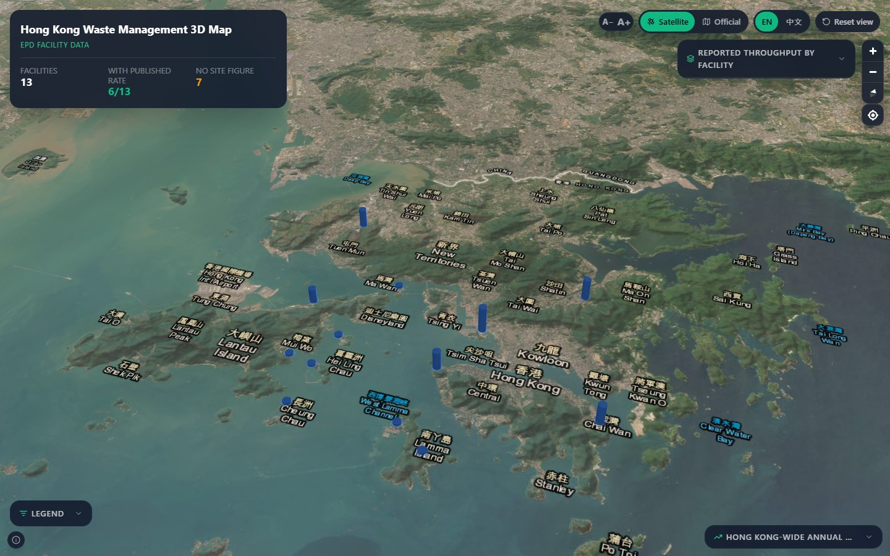
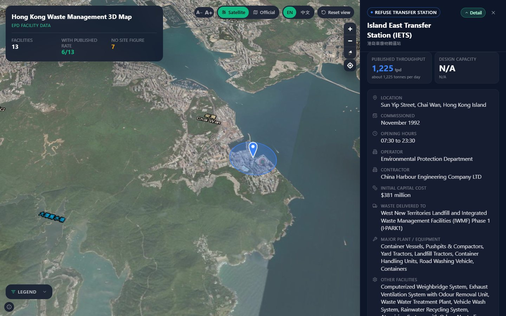

# Hong Kong Waste Management 3D Map

An interactive 3D map of Hong Kong's waste management facilities, built on
official EPD (Environmental Protection Department) data published through CSDI /
data.gov.hk.

Facilities are drawn as extruded pillars: **colour encodes the facility type**
and **height encodes published throughput**. Bilingual (English / 中文).

**Live:** <https://hkwastemap.vercel.app>

[](https://vercel.com/new/clone?repository-url=https%3A%2F%2Fgithub.com%2Fmattpenny%2Fwastemap)



## What it shows

19 mapped sites:

| Category | Count | Facilities |
| --- | --- | --- |
| Strategic landfill | 3 | WENT, NENT, SENT |
| Refuse transfer station (RTS) | 6 | IETS, IWTS, WKTS, STTS, NLTS, NWNTTS |
| Outlying Islands transfer facilities (OITF) | 7 | Mui Wo, Cheung Chau, Peng Chau, Hei Ling Chau, Yung Shue Wan, Sok Kwu Wan, Ma Wan |
| Waste-to-energy (I·PARK) | 1 | I·PARK1 |
| Organic recovery (O·PARK) | 1 | O·PARK1 |
| Yard waste (Y·PARK) | 1 | Y·PARK |

On load, every collapsible panel starts collapsed and the **RTS** filter is
pre-selected, so the app opens on the 13 transfer stations rather than all 19
sites at once. The "All" chip restores the full set.

## Data, and what it honestly does not say

Everything geographic and numeric comes from EPD. The project's guiding rule is
that a figure is never presented as more precise or more local than the source
actually is.

- **Per-facility source** — EPD "Waste Management Facilities", dataset
  `epd_rcd_1629267205235_29088`, layer `EPDWMF`, via
  [CSDI](https://portal.csdi.gov.hk/csdi-webpage/file-api?dataset_id=epd_rcd_1629267205235_29088&format=geojson&layer_name=EPDWMF)
  / [data.gov.hk](https://data.gov.hk/en-data/dataset/hk-epd-kmuteam-epdwmf).
  Names, addresses, coordinates and a **single current throughput snapshot**.
  That snapshot publishes a throughput for only **11 of the 19** mapped
  facilities.
- **No per-facility time series exists.** EPD publishes waste history only at
  territory level, so the trend chart is deliberately its own panel showing
  Hong Kong-wide annual disposal (2009–2024) and is never placed inside a
  facility card — a territory total shown in a facility card reads as if that
  facility receives that waste.
- **OITF has no per-site figures.** All seven sites are N.A. individually. The
  collapsed OITF row shows EPD's separate published **~90 tpd seven-site system
  total**, and it is labelled as such. Do not read it as a per-site rate.
- **Landfill "capacity" is remaining void volume**, in million m³ (WENT 61,
  NENT 35, SENT 43) — not a daily tonnage.
- **Pillar height means throughput only where a source and basis are stated.**
  A facility with no published site figure gets a short marker, not a guess.
- Per-facility detail rows (contractor, capital cost, commissioning date, waste
  types, area, aftercare, major plant) are transcribed from the EPD
  "Problems & Solutions" facility pages; each drawer links to its source page.

Source URLs, the provenance record and the disclaimer are all in
`src/data/waste-facilities.ts` (`OFFICIAL_DATA_SOURCES`, `DATA_PROVENANCE`) and
are surfaced in the UI — in the drawer and in the map "i" popover — rather than
buried in code.

### Measured intake, from the stations themselves

There is a **second, separate source**. Where an operator supplies its station
weighbridge export, the facility drawer gains a *Weighbridge records* block:
total received tonnage, average tonnes/day, weigh-in count, a daily intake
chart, and breakdowns by waste type, source district and who delivers it.

It is kept deliberately apart from the EPD figures directly above it, because
they are different kinds of number — a published rate versus measured intake.
Only weigh-ins marked **完成 (completed)** are counted; cancelled and rejected
weigh-ins are dropped, as are the station's own maintenance-vehicle loads
(reported separately so nothing is hidden). The block states the measured value
next to the EPD rate rather than letting the reader assume one is a cap on the
other.

Coverage today is **WKTS, 1–15 October 2026**: 12,015 weigh-ins, 50,033 t,
3,336 t/day. WKTS is the only transfer station that takes **grease trap waste**
(7,526 t over the period, 15.0% of its intake), and the UI says so.

Raw exports live in `data/` and are **gitignored** — they carry account numbers
and licence plates. `npm run ingest` reduces them to `src/data/weighbridge.json`
(about 7 KB, aggregates only) and aborts if any account number or plate survives
into the output. The same row format works for every RTS, so adding a station is
a matter of dropping its export into `data/` and re-running the ingest.

## Features

- 3D pillars via MapLibre GL + deck.gl, with a pitch/bearing view of Hong Kong.
- Two map styles, **no API keys required**: Esri World Imagery (default) and
  the Lands Department official map, whose labels switch language with the UI.
  Setting `NEXT_PUBLIC_MAPBOX_TOKEN` optionally upgrades the satellite slot to
  Mapbox `satellite-streets-v12`.
- Category filter chips (All / Landfills / RTS / Parks) and a legend with
  per-category counts. Both drive the same state, so they can never disagree.
- "Reported throughput by facility" ranking, highest first, with the seven OITF
  sites collapsed into one row that expands to its substations.
- Facility detail drawer: headline throughput/capacity figures by default, with
  the full EPD record behind a **Detail** toggle. The map shrinks to make room
  on desktop and becomes a bottom sheet on mobile. Stations with weighbridge
  coverage also get a measured-intake block — see
  [Measured intake](#measured-intake-from-the-stations-themselves).

  

- Separate Hong Kong-wide annual disposal panel, 2009–2024.
- A− / A+ font scaling that applies to all UI text, and an EN / 中文 toggle.
- **Phone layout:** the opening view is the title and the map, nothing else. The
  ranking, legend and trend panels live behind a dock pinned to the bottom edge,
  one sheet open at a time; the font / map-style / language / reset toolbar is
  collapsed behind a pill in the header card; and the header shows the facility
  counts only once you tap its chevron. Together that leaves ~79–85% of the
  viewport for the map instead of ~50%. From `lg` up every one of those
  disclosures goes away — the toolbar returns to its own row beside the header,
  the counts are always on, and each panel returns to its own corner.

## Getting started

Requires Node.js 18.17+ (developed on Node 22) and npm.

```bash
npm install
npm run dev
```

Open <http://localhost:3000>.

| Script | Purpose |
| --- | --- |
| `npm run dev` | Development server on port 3000 |
| `npm run build` | Production build |
| `npm start` | Serve the production build |
| `npm run lint` | ESLint (next lint) |
| `npm run typecheck` | `tsc --noEmit` |

There is no required environment configuration. `NEXT_PUBLIC_MAPBOX_TOKEN` is
optional and only changes the satellite basemap.

### A note on `WASTEMAP_DIST_DIR`

`next.config.mjs` reads `distDir` from `WASTEMAP_DIST_DIR`, defaulting to
`.next`. It exists as an escape hatch for environments whose file hooks refuse
to open `.next/trace` during a build; on such a machine use
`WASTEMAP_DIST_DIR=.next-alt npm run build`. You should not need it.

## HTTP API

`GET /api/waste-data` returns the facilities as a GeoJSON `FeatureCollection`,
with CORS open and an ETag so repeat requests can be answered with `304`.

| Parameter | Effect |
| --- | --- |
| `category=Landfill,RTS` | Filter to one or more categories (comma separated) |
| `id=landfill-went` | Return a single facility |
| `lang=zh` | Hint for consumers; properties already carry both languages |
| `pretty=1` | Pretty-print the JSON |

Invalid `category` returns `400`, unknown `id` returns `404`. The response
`metadata` mirrors `DATA_PROVENANCE` in `src/data/waste-facilities.ts`; keep the
two in step when changing fields.

`GET /api/station-data` returns measured station intake from the operator
weighbridge records — the same aggregates the drawer renders.

| Parameter | Effect |
| --- | --- |
| *(none)* | Every station with weighbridge coverage |
| `station=WKTS` | One station, by operator code |
| `facility=rts-west-kowloon` | One station, by map facility id |
| `pretty=1` | Pretty-print the JSON |

Unknown stations, and facilities with no coverage, return `404`. This route is
intentionally separate from `/api/waste-data`: one is the EPD facility register,
the other is measured operator data, and merging them would invite exactly the
conflation the project is built to avoid.

## Verification

Two scripts under `scripts/` verify the app end to end — one against the API
payload, one against the rendered UI. Both need a running dev server, and both
exit non-zero on failure.

```bash
npm run dev            # in one terminal
node scripts/verify-api.mjs        # 112 payload assertions
node scripts/verify-browser.mjs    # 112 in-browser assertions
```

`verify-browser.mjs` drives a real browser and writes screenshots to
`out/verify/`. It covers the desktop layout — including a guard that each panel
stays in its own corner, that the toolbar is still its own row beside the
header, and that the phone dock and its disclosures are absent — plus a 390px
mobile pass. The mobile pass asserts that the dock is pinned to the bottom edge
with all three tabs, that no sheet is open on load, that tapping a tab opens the
right sheet and closes the others, that the map keeps at least 75% of the
viewport, that the title stays on one line (even with the type scaled up), and
that nothing overflows horizontally. It also drives the two header disclosures:
both start closed, the chevron reveals the counts and hides them again, the pill
opens the toolbar *inside* the header card, A+ / A− still work from there, and
the desktop copy of the toolbar stays hidden.

`verify-api.mjs` also covers `/api/station-data`: that only 完成 weigh-ins are
counted, that the daily / waste-type / district / stream breakdowns all
reconcile to the same intake total, that maintenance tonnage is reported
separately and is not one of the intake streams, that the `S42.00` typo and
case duplicates collapse to one row, and that no account number, plate or
permitted-weight field reaches the payload.

`verify-browser.mjs` drives the WKTS drawer too, and asserts the bar *geometry*
rather than just the text — an earlier build passed `Array.map`'s index as the
share, so the bars read 0%, 100%, 200%… and every one past the first was clipped
to full width, which looked entirely plausible on screen.

It uses
Playwright, which is intentionally **not** a dependency
of this project; `scripts/_playwright.mjs` loads it in this order:

1. a local `playwright` install (`npm i -D playwright`), else
2. the path in `$PW_PATH` (absolute path to `playwright/index.js`), else
3. an error explaining both options.

It prefers an installed Chrome and falls back to Playwright's bundled Chromium.

`verify-debug.mjs` is a scratch probe for inspecting what renders at given
viewport coordinates; it is not part of the test suite. `_probe-mobile.mjs`
audits the layout at three phone widths and reports the title's line count, any
element overflowing the viewport, and whether each dock sheet stays on screen.
`_shot-mobile.mjs` screenshots the opening view, both header disclosures, and
each dock sheet at three phone widths. `_shot-weighbridge.mjs` screenshots the
WKTS drawer on desktop and at 390px, top and bottom.

## Project layout

```
src/app/               App Router pages, layout, globals.css
src/app/api/waste-data Data proxy returning GeoJSON (EPD facility register)
src/app/api/station-data  Measured station intake (operator weighbridge records)
src/components/map/    MapLibre + deck.gl map, basemap style definitions
src/components/ui/     Drawer, weighbridge block, trend panel, legend chrome
src/data/              Facility dataset, provenance, HK-wide trend, weighbridge aggregate
src/lib/               Category metadata, i18n, weighbridge types, formatting helpers
scripts/               Ingest + verification scripts and shared Playwright loader
data/                  Raw weighbridge exports (gitignored — see the data section)
docs/                  Screenshots used by this README
```

`src/app/page.tsx` is the single source of UI state; the map and the drawer are
presentational.

### Regenerating the weighbridge aggregate

```bash
# drop the operator's export(s) into data/, then:
npm run ingest
```

The script keeps 完成 weigh-ins, normalises the waste-type codes, separates the
station's own maintenance loads, and writes `src/data/weighbridge.json`. It
refuses to write if any account number or licence plate from the input appears
in the output. The same row format works for every RTS.

## Tech

Next.js 14 (App Router) · React 18 · TypeScript · Tailwind CSS 3 · MapLibre GL 5
· deck.gl 9 (via `MapboxOverlay`) · Recharts 2 · lucide-react.

## Attribution

Facility data © Environmental Protection Department, the Government of the
Hong Kong Special Administrative Region, made available via CSDI and
data.gov.hk. Basemaps © Esri and its data providers, and the Lands Department
MapAPI. Please retain the on-map attribution.

This is an independent visualisation and is not an official EPD product.
